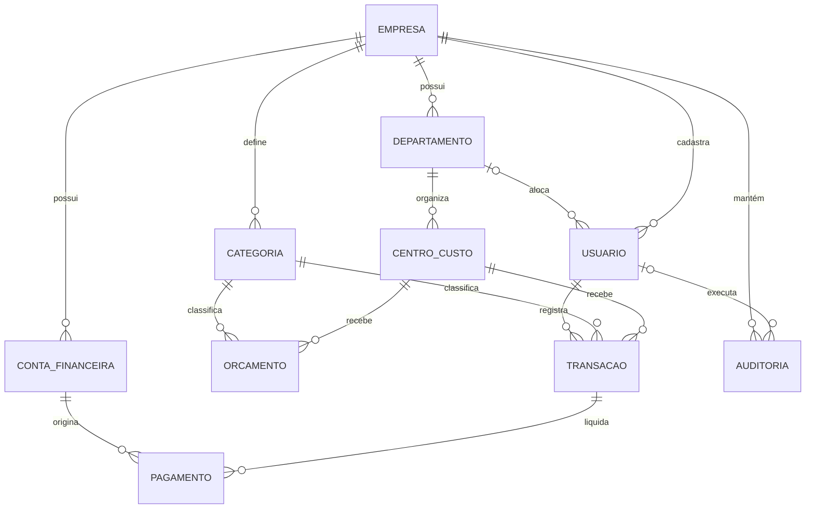

# DER — FinControl (modelo inicial)

## Observações

- As chaves estrangeiras compostas com `id_empresa` impedem relacionamentos entre registros de empresas diferentes em entidades financeiras.
- Uma transação pode ter vários pagamentos, permitindo representar liquidações parciais.
- O valor total pago e o status da transação ainda precisam de regra transacional/trigger na próxima evolução.
- A auditoria está modelada, mas a gravação automática ainda não foi implementada.
