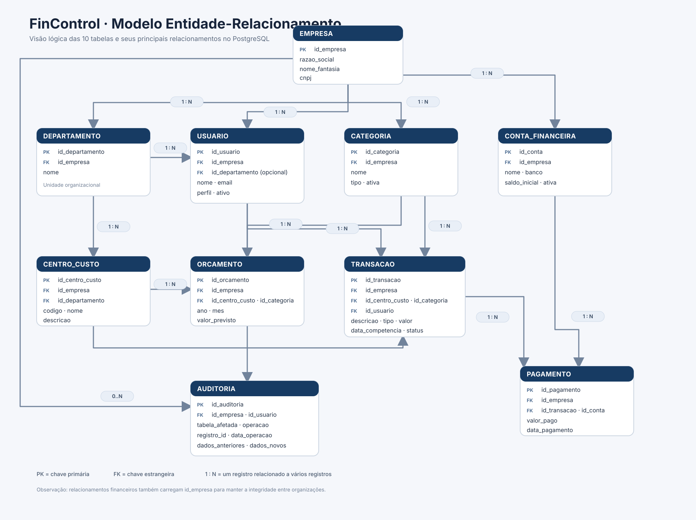

# DER — FinControl

O modelo representa as dez tabelas principais do projeto e os relacionamentos
entre empresa, estrutura organizacional, classificação financeira, orçamento,
transações, pagamentos e auditoria.

## Entidades

- empresa: organização proprietária dos dados.
- departamento: unidades organizacionais vinculadas à empresa.
- centro_custo: centros de custo vinculados a departamentos.
- usuario: usuários, perfis e departamento opcional.
- categoria: classificação de receitas e despesas.
- conta_financeira: contas financeiras da empresa.
- orcamento: valores planejados por centro de custo, categoria e período.
- transacao: lançamentos de receitas e despesas.
- pagamento: liquidações totais ou parciais de transações.
- auditoria: histórico de operações registradas por triggers.

## Relacionamentos principais

- Uma empresa possui departamentos, usuários, categorias e contas financeiras.
- Um departamento organiza centros de custo e pode ter usuários alocados.
- Um centro de custo e uma categoria classificam orçamentos e transações.
- Um usuário pode registrar várias transações.
- Uma transação pode ter vários pagamentos.
- Uma conta financeira pode originar vários pagamentos.
- A auditoria registra operações relacionadas à empresa e, quando disponível, ao usuário responsável.

## Integridade e regras

- As chaves estrangeiras compostas com id_empresa impedem relacionamentos
  entre registros de empresas diferentes nas entidades financeiras.
- Uma transação pode ter vários pagamentos, permitindo representar
  liquidações parciais.
- O script database/sql/08_triggers.sql implementa validação de pagamentos,
  recálculo de status e auditoria automática para transações e pagamentos.
- O contexto app.user_id pode ser definido pela aplicação dentro da
  transação para identificar o usuário responsável pela operação. Sem esse
  contexto, id_usuario na auditoria pode permanecer nulo para eventos
  originados em pagamentos.

## Arquivos relacionados

- Estrutura e constraints: database/sql/02_schema.sql
- Views: database/sql/03_views.sql
- Triggers: database/sql/08_triggers.sql
- Dicionário de dados: docs/data_dictionary.md

O diagrama é uma visão lógica simplificada. Os detalhes completos de colunas,
constraints e índices estão definidos nos scripts SQL.
